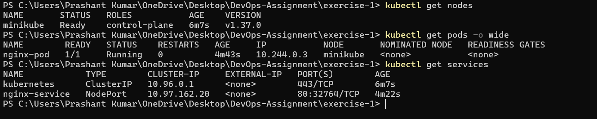
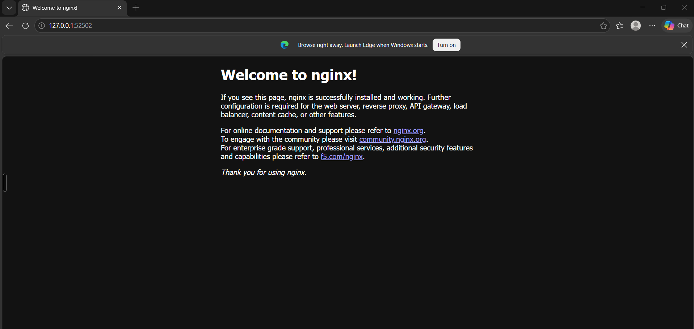

# Exercise 1 — Kubernetes Getting Started

## Objective
Start a local Kubernetes cluster with Minikube, run Nginx as a Pod, expose it with a Service and open it in the browser.

## Steps

### 1. Start the cluster
```powershell
minikube start --driver=docker
kubectl get nodes
```

### 2. Create the Nginx Pod
```powershell
kubectl apply -f nginx-pod.yaml
kubectl get pods
kubectl describe pod nginx-pod
```

### 3. Expose the Pod as a Service
```powershell
kubectl expose pod nginx-pod --type=NodePort --port=80 --name=nginx-service
kubectl get services
```

### 4. Open the application
```powershell
minikube service nginx-service
```


> 📸 Screenshot: PowerShell window showing all of the commands above and their output.

## Result

> 📸 Screenshot: browser showing the "Welcome to nginx!" page.

Nginx ran as a Kubernetes Pod on Minikube and was reachable through a NodePort Service.

## Cleanup
```powershell
kubectl delete service nginx-service
kubectl delete pod nginx-pod
```
