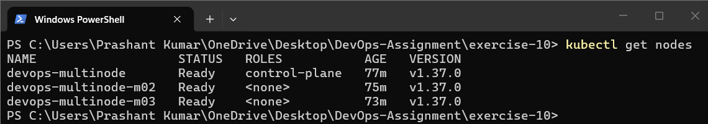
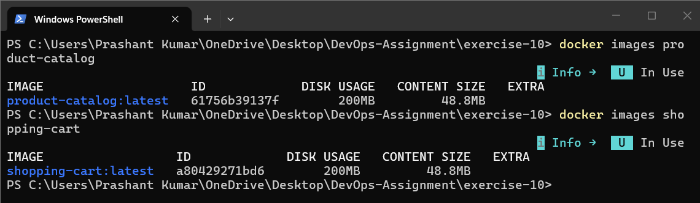
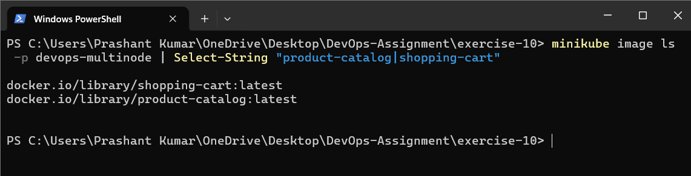
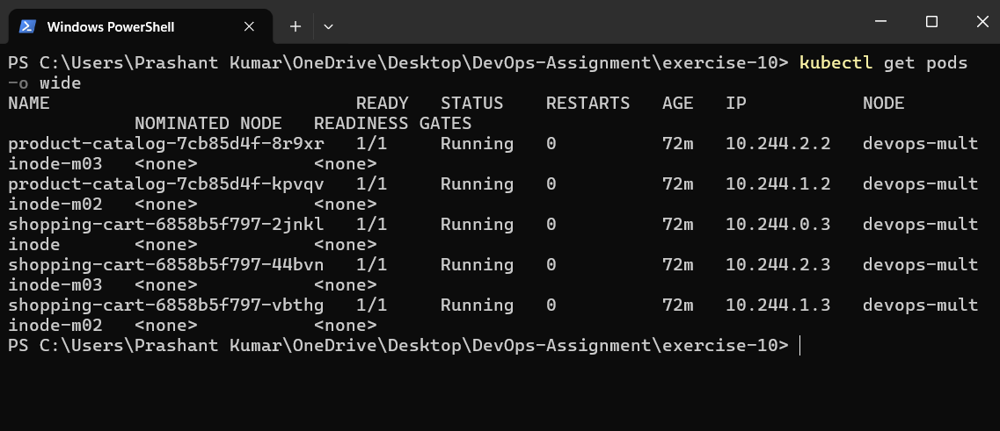
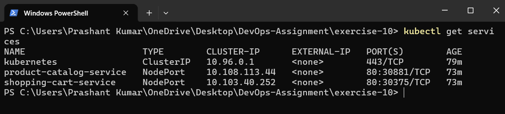
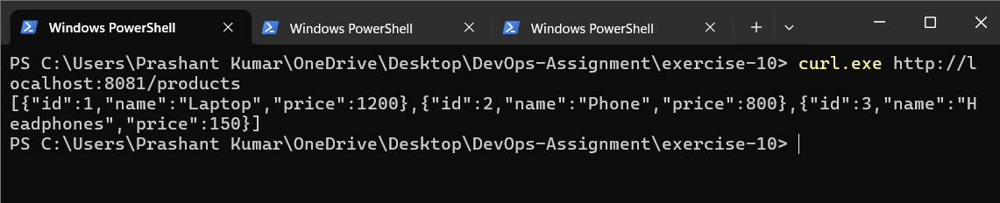
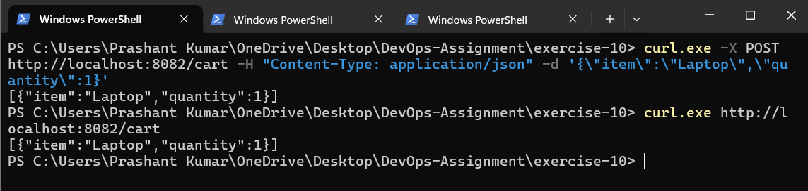

# Exercise 10 — Multi-Node Kubernetes Cluster with Multiple Applications

## Objective
Deploy two Flask microservices on a three-node Minikube cluster, spreading replicas across nodes with pod anti-affinity and exposing them with NodePort Services.

| App | Replicas | Endpoint |
|-----|----------|----------|
| Product Catalog | 2 | `GET /products` |
| Shopping Cart | 3 | `GET /cart`, `POST /cart` |

## Files
- `product_catalog.py`, `Dockerfile.product`
- `shopping_cart.py`, `Dockerfile.shopping`
- `product_catalog_deployment.yaml`, `product_catalog_service.yaml`
- `shopping_cart_deployment.yaml`, `shopping_cart_service.yaml`

## Steps

### 1. Start a 3-node cluster
```powershell
minikube start --nodes=3 -p devops-multinode
kubectl get nodes
```


### 2. Build the images
```powershell
docker build -t product-catalog:latest -f Dockerfile.product .
docker build -t shopping-cart:latest -f Dockerfile.shopping .
docker images
```


### 3. Load them into Minikube
```powershell
minikube image load product-catalog:latest -p devops-multinode
minikube image load shopping-cart:latest -p devops-multinode
minikube image ls -p devops-multinode
```


### 4. Deploy
```powershell
kubectl apply -f product_catalog_deployment.yaml
kubectl apply -f product_catalog_service.yaml
kubectl apply -f shopping_cart_deployment.yaml
kubectl apply -f shopping_cart_service.yaml

kubectl get deployments
kubectl get replicasets
kubectl get pods -o wide
```

> 📸 Screenshot: 5 pods `Running`, each app's replicas on different nodes.

### 5. Services
```powershell
kubectl get services
kubectl get endpoints
```


### 6. Test Product Catalog
```powershell
minikube service product-catalog-service --url -p devops-multinode
curl.exe http://127.0.0.1:<PORT>/products
```


### 7. Test Shopping Cart
```powershell
minikube service shopping-cart-service --url -p devops-multinode
curl.exe -X POST http://127.0.0.1:<PORT>/cart -H "Content-Type: application/json" -d '{\"item\":\"Laptop\",\"quantity\":1}'
curl.exe http://127.0.0.1:<PORT>/cart
```


## Conclusion
Both apps ran on a three-node cluster with replicas spread across nodes by anti-affinity, reached `2/2` and `3/3` ready, and their APIs responded through NodePort Services.
