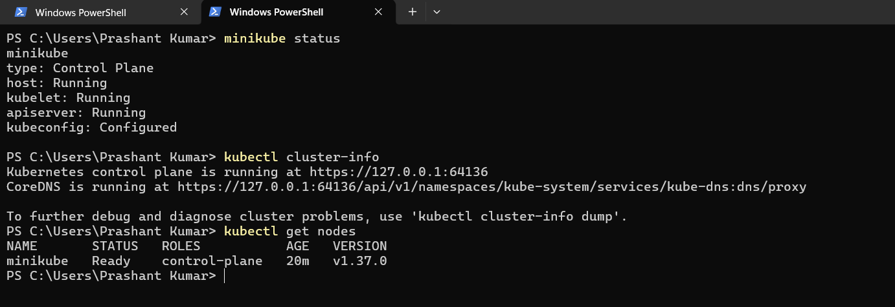
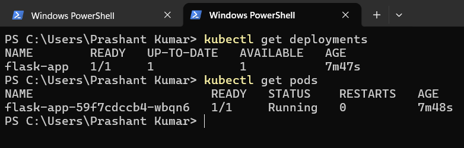
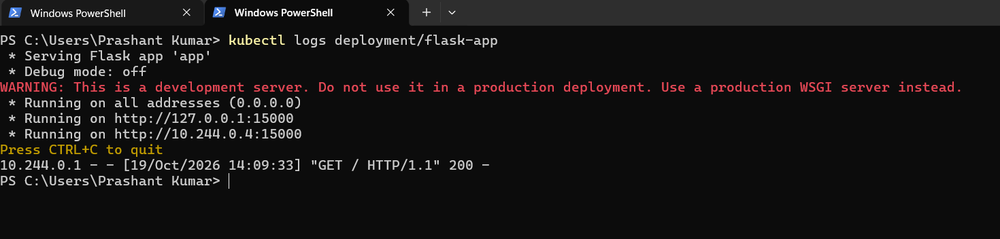
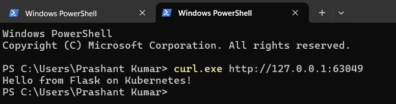

# Exercise 2 — Deploy a Flask App on Minikube

## Objective
Containerise a Flask app with Docker and deploy it to Minikube using a Deployment and a NodePort Service.

## Files
| File | Purpose |
|------|---------|
| `app.py` | Flask app on port **15000** returning `Hello from Flask on Kubernetes!` |
| `Dockerfile` | Builds the `flask-app` image |
| `flask-deployment.yaml` | Deployment (1 replica) + NodePort Service |

## Steps

### 1. Start Minikube
```powershell
minikube start
minikube status
kubectl cluster-info
kubectl get nodes
```

> 📸 Screenshot: `minikube status` and `kubectl get nodes` output.

### 2. Build the image and deploy
```powershell
docker build -t flask-app .
minikube image load flask-app:latest
kubectl apply -f flask-deployment.yaml
kubectl get deployments
kubectl get pods
```

> 📸 Screenshot: deployment `1/1` ready and the pod `Running`.

### 3. Check the logs
```powershell
kubectl logs <pod-name>
```

> 📸 Screenshot: logs showing Flask running on port 15000.

### 4. Access the service
```powershell
minikube service flask-app-service --url
curl.exe http://127.0.0.1:<PORT>
```
Expected output:
```text
Hello from Flask on Kubernetes!
```

> 📸 Screenshot: the service URL and the curl response.

## Conclusion
The Flask app was containerised, deployed on Minikube and reached through a NodePort Service from PowerShell.
