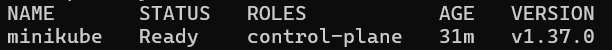
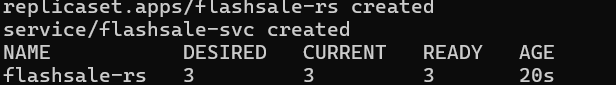
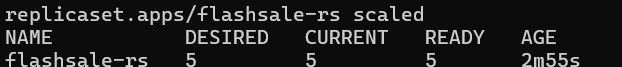
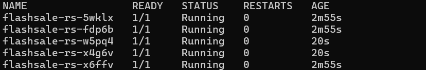
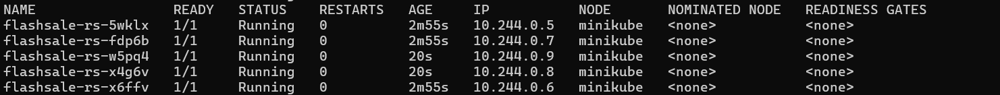
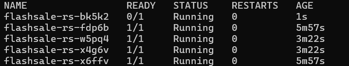
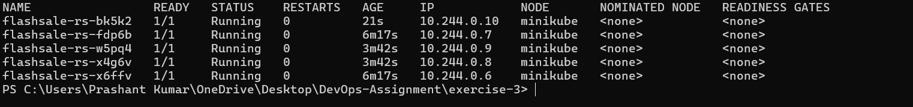

# Exercise 3 — Scaling a Flask App with ReplicaSets

## Objective
Run a "flash sale" Flask app with a ReplicaSet, scale it from 3 to 5 replicas and show self-healing on a single-node Minikube cluster.

## Files
| File | Purpose |
|------|---------|
| `app.py` | Flask app with `/`, `/buy` and `/health` endpoints, each reporting the pod name |
| `Dockerfile` | Runs the app with Gunicorn on port 5000 |
| `flashsale-replicaset.yaml` | ReplicaSet (3 replicas, probes, resource limits) + ClusterIP Service |

## Steps

### 1. Start a single-node cluster and build the image
```powershell
minikube start --nodes=1
docker build -t flashsale:1.1 .
minikube image load flashsale:1.1
```

> 📸 Screenshot: `kubectl get nodes` showing one node.

### 2. Deploy the ReplicaSet (3 replicas)
```powershell
kubectl apply -f flashsale-replicaset.yaml
kubectl get rs
```

> 📸 Screenshot: `flashsale-rs` with DESIRED 3 / READY 3.

### 3. Scale to 5
```powershell
kubectl scale rs flashsale-rs --replicas=5
kubectl get rs
```

> 📸 Screenshot: DESIRED 5 / READY 5.

### 4. Verify five pods
```powershell
kubectl get pods -l app=flashsale
```


### 5. Check pod placement
```powershell
kubectl get pods -l app=flashsale -o wide
```

> 📸 Screenshot: all five pods on the `minikube` node.

### 6. Test the app
```powershell
kubectl port-forward svc/flashsale-svc 8080:80
curl.exe http://localhost:8080/buy?user=prashant
```

### 7. Self-healing
```powershell
kubectl delete pod <POD_NAME>
kubectl get pods -l app=flashsale
```

> 📸 Screenshot: the deleted pod gone and a new one being created.

### 8. Final state
```powershell
kubectl get pods -l app=flashsale -o wide
```


## Conclusion
The ReplicaSet kept the desired replica count, scaled from 3 to 5 on demand and replaced a deleted pod automatically.
