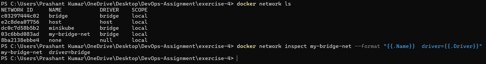
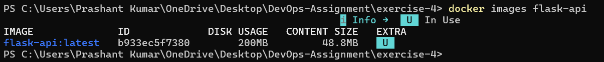
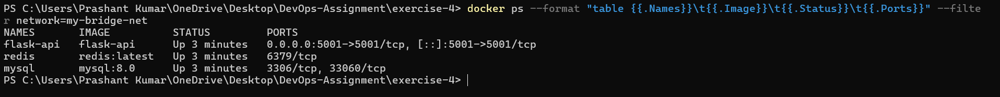
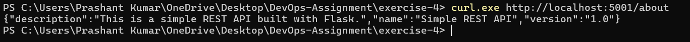
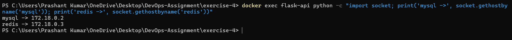
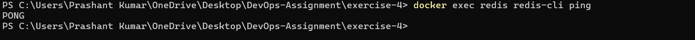
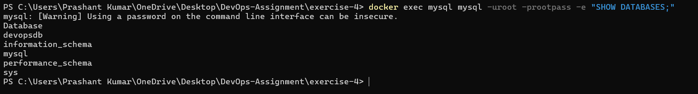

# Exercise 4 — Docker Networking

## Objective
Connect a Flask API, MySQL and Redis on a user-defined bridge network, expose Flask to the host and show container-to-container DNS.

## Files
| File | Purpose |
|------|---------|
| `app.py` | Flask API with an `/about` endpoint on port 5001 |
| `requirements.txt` | Flask and Werkzeug versions |
| `Dockerfile` | Builds the `flask-api` image |

## Steps

### 1. Create the network
```powershell
docker network create my-bridge-net
docker network ls
```


### 2. Build the Flask image
```powershell
docker build -t flask-api .
```


### 3. Run the three containers
```powershell
docker run -d --name mysql --network my-bridge-net `
  -e MYSQL_ROOT_PASSWORD=rootpass -e MYSQL_DATABASE=devopsdb mysql:8.0

docker run -d --name redis --network my-bridge-net redis:latest

docker run -d --name flask-api --network my-bridge-net -p 5001:5001 flask-api

docker ps
```


### 4. Test the API from the host
```powershell
curl.exe http://localhost:5001/about
```


### 5. Docker DNS / service discovery
```powershell
docker exec flask-api python -c "import socket; print('mysql ->', socket.gethostbyname('mysql')); print('redis ->', socket.gethostbyname('redis'))"
```


### 6. Verify Redis
```powershell
docker exec redis redis-cli ping
```


### 7. Verify MySQL
```powershell
docker exec mysql mysql -uroot -prootpass -e "SHOW DATABASES;"
```

> 📸 Screenshot: `devopsdb` in the database list.

## Architecture
```text
Windows host
    | localhost:5001
    v
  flask-api
    |  my-bridge-net
    +---- mysql
    +---- redis
```

## Cleanup
```powershell
docker rm -f flask-api mysql redis
docker network rm my-bridge-net
```

## Conclusion
Flask was published to the host on port 5001 while reaching MySQL and Redis by container name over the custom bridge network.
