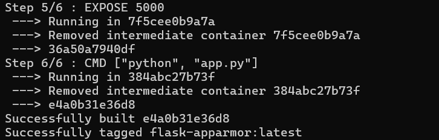
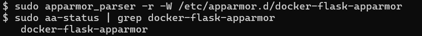
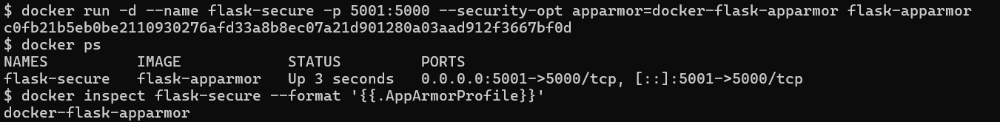
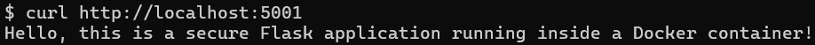
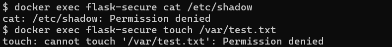
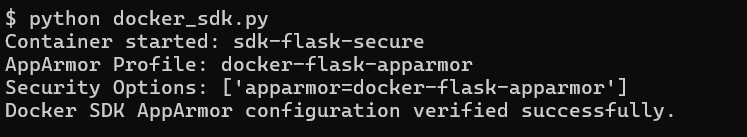

# Exercise 5 — Docker Security with AppArmor

## Objective
Apply a custom AppArmor profile to a Flask container to block access to sensitive files and admin capabilities, and verify it with the Docker SDK for Python.

## Environment
Windows → WSL2 → Ubuntu 24.04 → Docker Engine with AppArmor. Run everything below **inside the Ubuntu terminal**.

## Files
| File | Purpose |
|------|---------|
| `app.py` | Flask app on port 5000 |
| `Dockerfile` | Builds the `flask-apparmor` image |
| `docker-flask-apparmor` | The AppArmor profile |
| `docker_sdk.py` | Starts a container with the profile and prints its security options |
| `requirements.txt` | `docker` SDK |

## Steps

### 1. Build the image
```bash
docker build -t flask-apparmor .
```


### 2. Load the AppArmor profile
```bash
sudo cp docker-flask-apparmor /etc/apparmor.d/
sudo apparmor_parser -r -W /etc/apparmor.d/docker-flask-apparmor
sudo aa-status | grep docker-flask-apparmor
```


### 3. Run the container with the profile
```bash
docker run -d --name flask-secure -p 5001:5000 \
  --security-opt apparmor=docker-flask-apparmor flask-apparmor
docker inspect flask-secure --format '{{.AppArmorProfile}}'
```


### 4. Test the app
```bash
curl http://localhost:5001
```


### 5. Test the restrictions
```bash
docker exec flask-secure cat /etc/shadow
docker exec flask-secure touch /var/test.txt
```
Both should fail with `Permission denied`.



### 6. Verify with the Docker SDK
```bash
python3 -m venv .venv && source .venv/bin/activate
pip install -r requirements.txt
python docker_sdk.py
```


## Cleanup
```bash
docker rm -f flask-secure sdk-flask-secure
```

## Conclusion
The Flask app ran normally under the custom AppArmor profile while reads of `/etc/shadow` and writes under `/var` were denied, and the Docker SDK confirmed the profile was applied.
