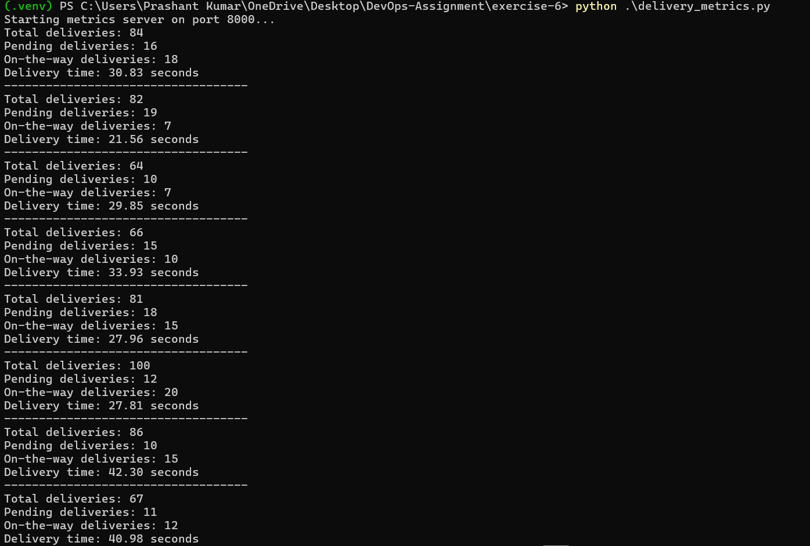
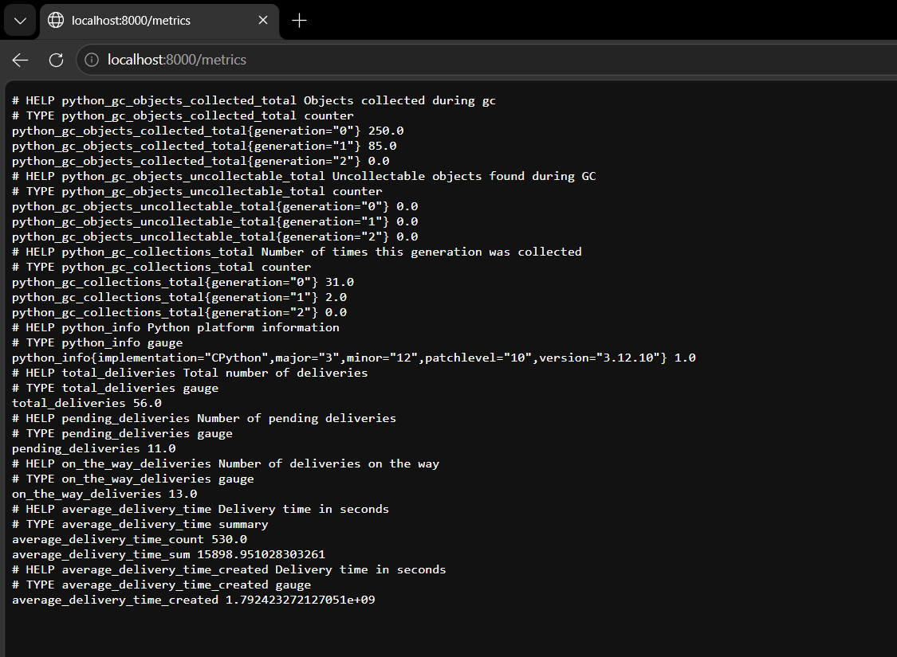
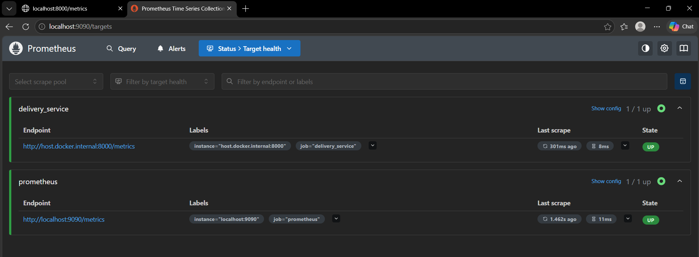
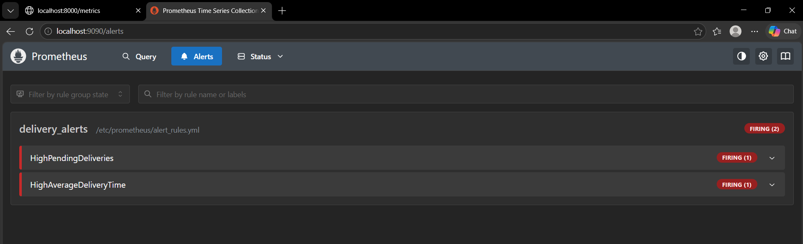
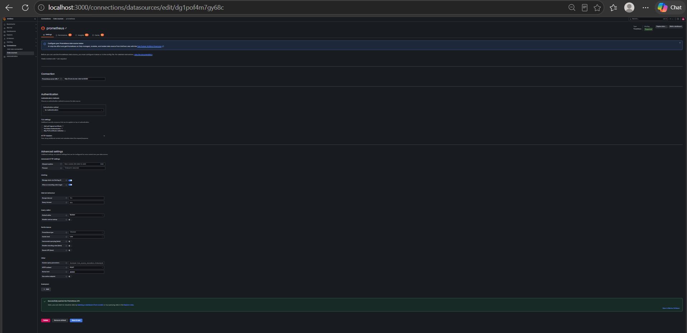
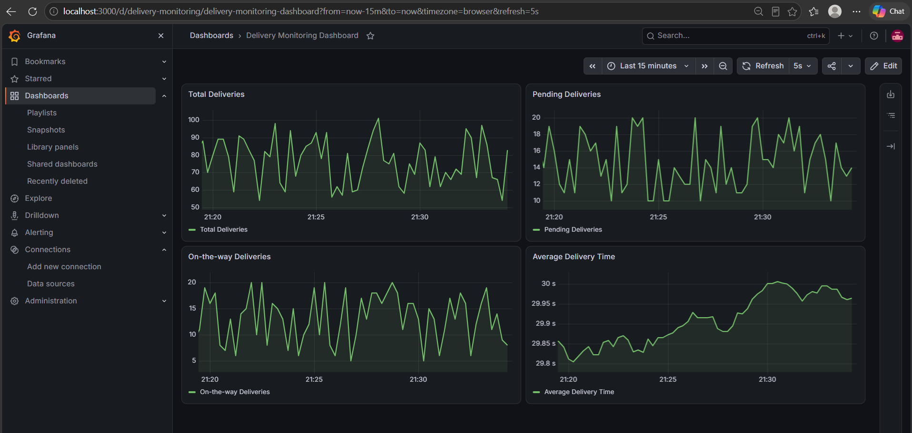
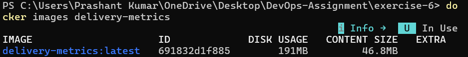
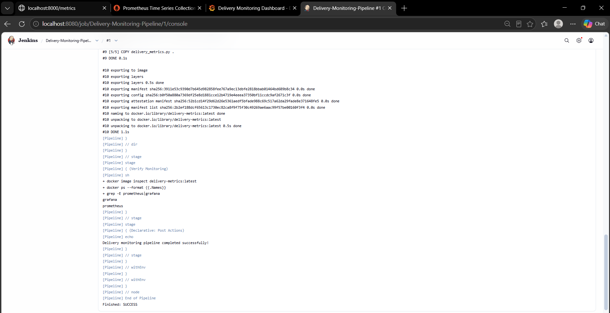

# Exercise 6 — Real-Time Monitoring and Alerting

## Objective
Build a delivery-service monitoring setup: a Python app exports metrics, Prometheus scrapes them and evaluates alerts, Grafana visualises them, and Jenkins validates and builds the image.

## Components
| Component | Port | Role |
|-----------|------|------|
| `delivery_metrics.py` | 8000 | Simulates total / pending / on-the-way deliveries and delivery time |
| Prometheus | 9090 | Scrapes metrics, evaluates `alert_rules.yml` |
| Grafana | 3000 | Dashboard |
| Jenkins | 8080 | Runs the `Jenkinsfile` pipeline |

## Steps

### 1. Run the metrics app
```powershell
python -m venv .venv
.\.venv\Scripts\Activate.ps1
pip install -r requirements.txt
python .\delivery_metrics.py
```


Open http://localhost:8000/metrics



### 2. Run Prometheus
In a new PowerShell window, from this folder:
```powershell
docker run -d --name prometheus -p 9090:9090 `
  -v ${PWD}/prometheus.yml:/etc/prometheus/prometheus.yml `
  -v ${PWD}/alert_rules.yml:/etc/prometheus/alert_rules.yml `
  prom/prometheus
```
Open http://localhost:9090 → **Status → Targets**: both jobs should be `UP`.



**Alerts** tab: `HighPendingDeliveries` should go to *Firing*.



### 3. Run Grafana
```powershell
docker run -d --name grafana -p 3000:3000 grafana/grafana
```
Log in at http://localhost:3000 (admin / admin) → add a Prometheus data source with URL `http://host.docker.internal:9090` → **Save & test**.



Create a dashboard with four panels and 5-second auto-refresh:
- `total_deliveries`
- `pending_deliveries`
- `on_the_way_deliveries`
- `average_delivery_time_sum / average_delivery_time_count`



### 4. Build the app image
```powershell
docker build -t delivery-metrics:latest .
```


### 5. Jenkins pipeline
```powershell
docker build -t jenkins-docker -f Dockerfile.jenkins .
docker run -d --name jenkins-monitoring -u root -p 8080:8080 `
  -v jenkins_home:/var/jenkins_home `
  -v /var/run/docker.sock:/var/run/docker.sock jenkins-docker
```
Create a Pipeline job **Delivery-Monitoring-Pipeline** → *Pipeline script from SCM* → this repo, branch `main`, script path `exercise-6/Jenkinsfile` → **Build Now**.



> **Note:** Jenkins runs as root with the Docker socket mounted so it can control Docker Desktop. That is fine for a local lab but should not be used on a shared or production Jenkins.

## Alert rules
- **HighPendingDeliveries** — `pending_deliveries > 10` for 15 s (warning)
- **HighAverageDeliveryTime** — average delivery time > 30 s for 15 s (critical)

## Conclusion
Metrics flowed from the Python app into Prometheus and Grafana, the pending-deliveries alert fired as expected, and Jenkins built the image and verified the monitoring stack.
