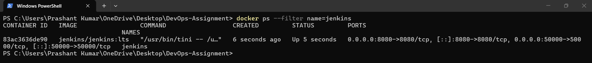
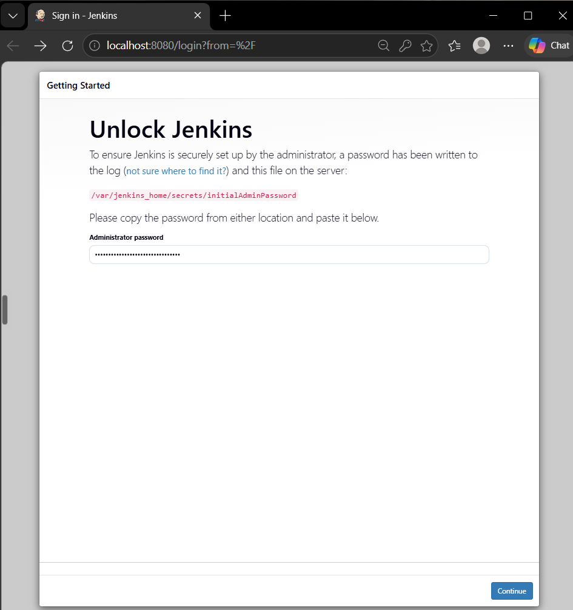
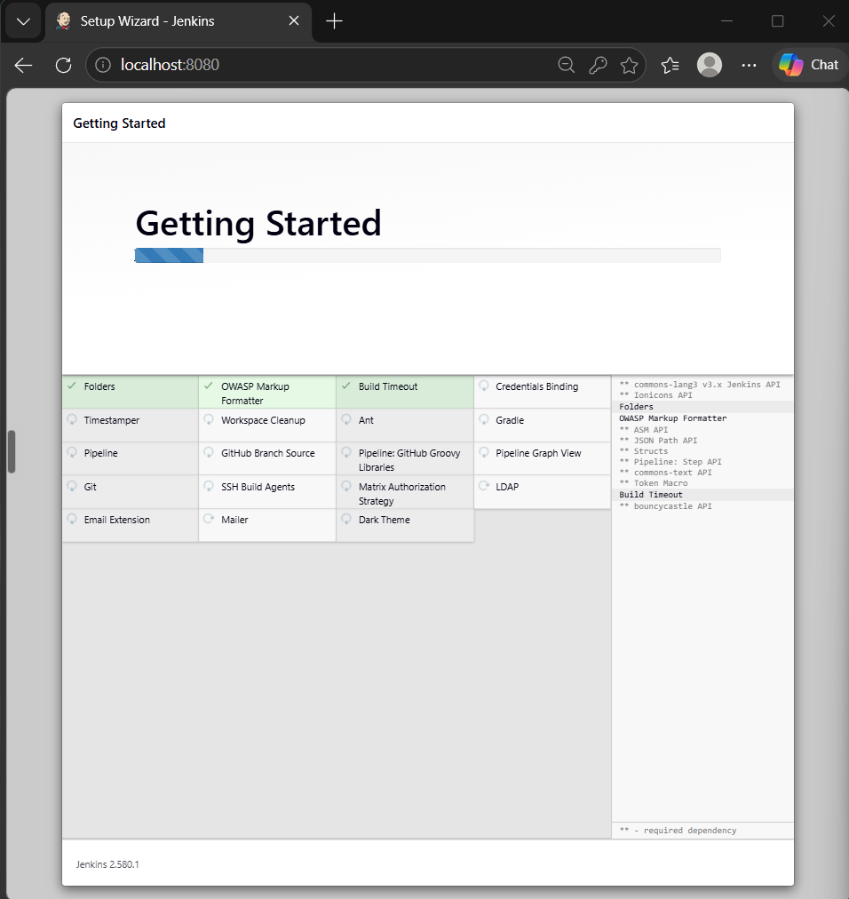
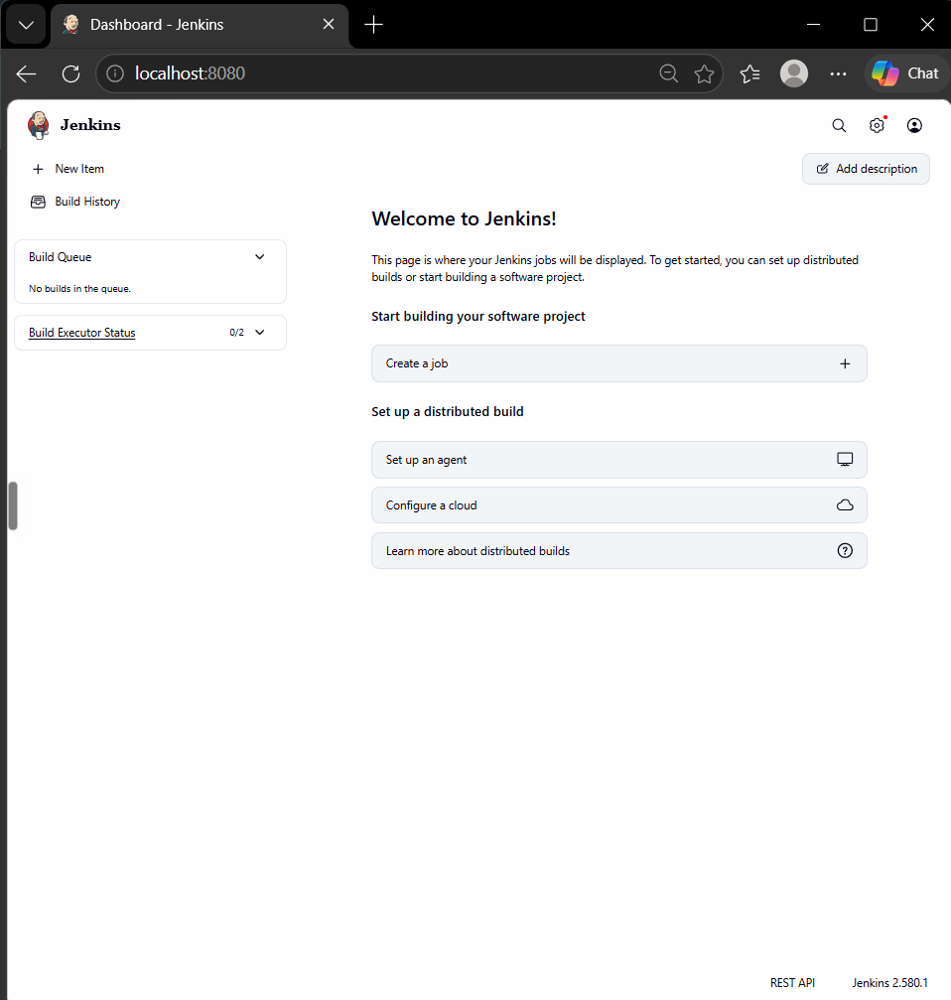

# Exercise 7 — Introduction to CI and Jenkins Installation

## Continuous Integration
CI means merging code into a shared repository often, with every change built and tested automatically so problems surface early. Common tools include Jenkins, GitHub Actions, GitLab CI/CD, CircleCI, Travis CI, Azure Pipelines, TeamCity and Bamboo.

## Jenkins terms
- **Job** — a task Jenkins runs
- **Build** — one run of a job
- **Pipeline** — a scripted sequence of build / test / deploy stages
- **Plugin** — adds features and integrations
- **Node** — a machine that runs jobs

## Installation (Docker Desktop on Windows)
```powershell
docker volume create jenkins_home
docker pull jenkins/jenkins:lts

docker run -d `
  --name jenkins `
  --restart unless-stopped `
  -p 8080:8080 `
  -p 50000:50000 `
  -v jenkins_home:/var/jenkins_home `
  jenkins/jenkins:lts
```

> 📸 Screenshot: `docker ps` showing the `jenkins` container.

Get the initial admin password:
```powershell
docker exec jenkins cat /var/jenkins_home/secrets/initialAdminPassword
```
Open http://localhost:8080 and paste it in.



Choose **Install suggested plugins**.



Create the admin user and finish the wizard.



## Verification
```powershell
docker ps
docker inspect jenkins --format '{{.State.Status}}'
docker volume inspect jenkins_home
```
The container state should be `running`; the `jenkins_home` volume keeps Jenkins data if the container is recreated.

## Result
Jenkins was installed with Docker Desktop and the dashboard opened in the browser.
