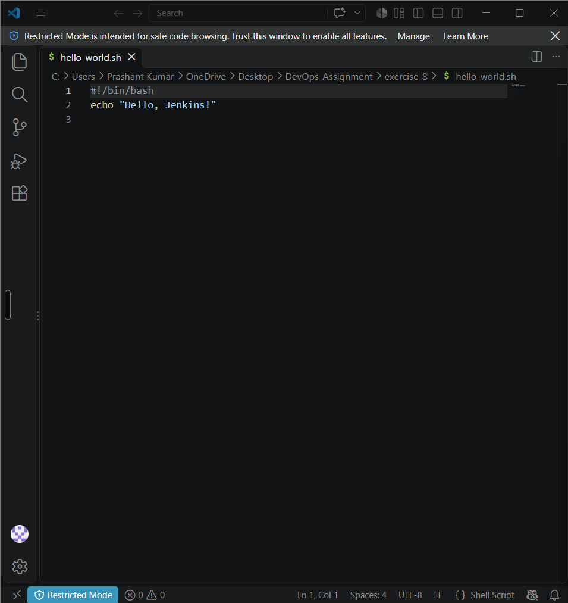
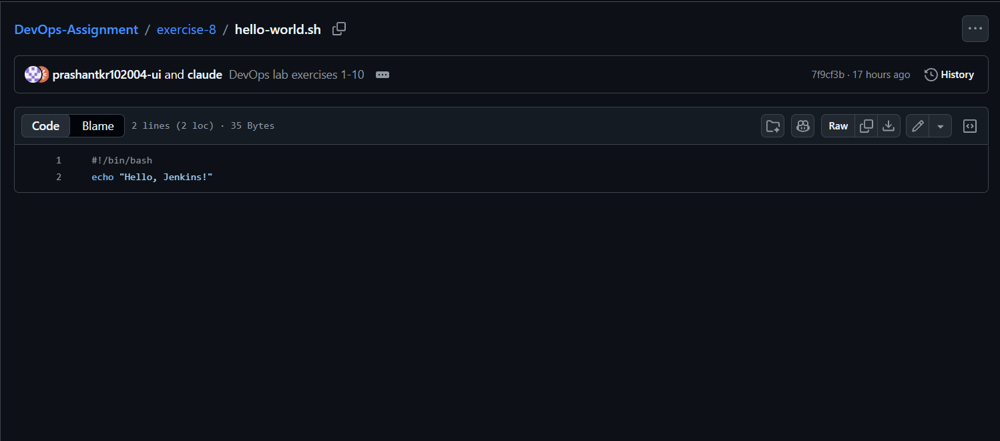
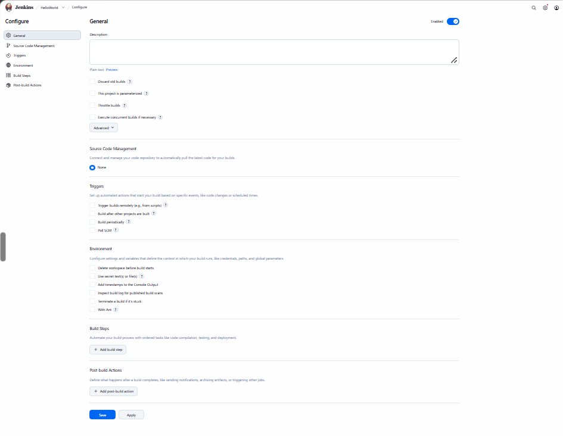
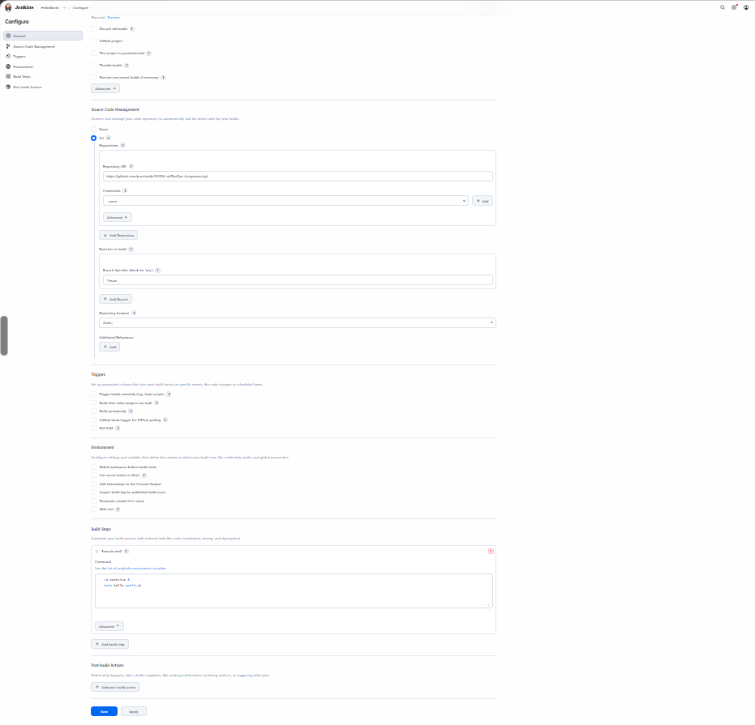
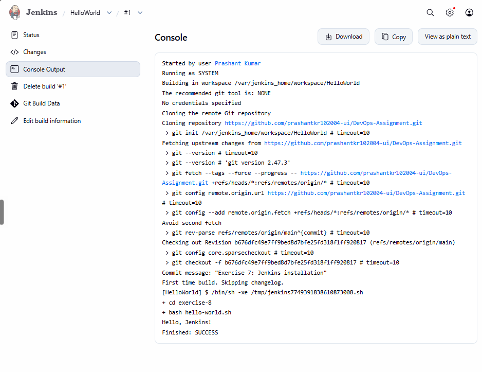

# Exercise 8 — Hello World Jenkins Job

## Objective
Create a Jenkins Freestyle job that pulls a shell script from GitHub and prints `Hello, Jenkins!`.

## Steps
1. Create `hello-world.sh`:
   ```bash
   #!/bin/bash
   echo "Hello, Jenkins!"
   ```
   

2. Commit and push it to [my DevOps-Assignment repository](https://github.com/prashantkr102004-ui/DevOps-Assignment).

   

3. In Jenkins: **New Item → HelloWorld → Freestyle project**.

   

4. **Source Code Management → Git**: repository URL `https://github.com/prashantkr102004-ui/DevOps-Assignment.git`, branch `*/main`.
   **Build Steps → Execute shell**:
   ```bash
   cd exercise-8
   bash hello-world.sh
   ```
   

5. **Save → Build Now** and open the console output.

   
   > 📸 Screenshot: console showing `Hello, Jenkins!` and `Finished: SUCCESS`.

## Result
The job checked out the repo, ran the script and printed `Hello, Jenkins!` with `Finished: SUCCESS`.
