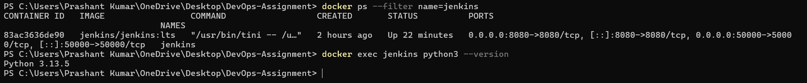
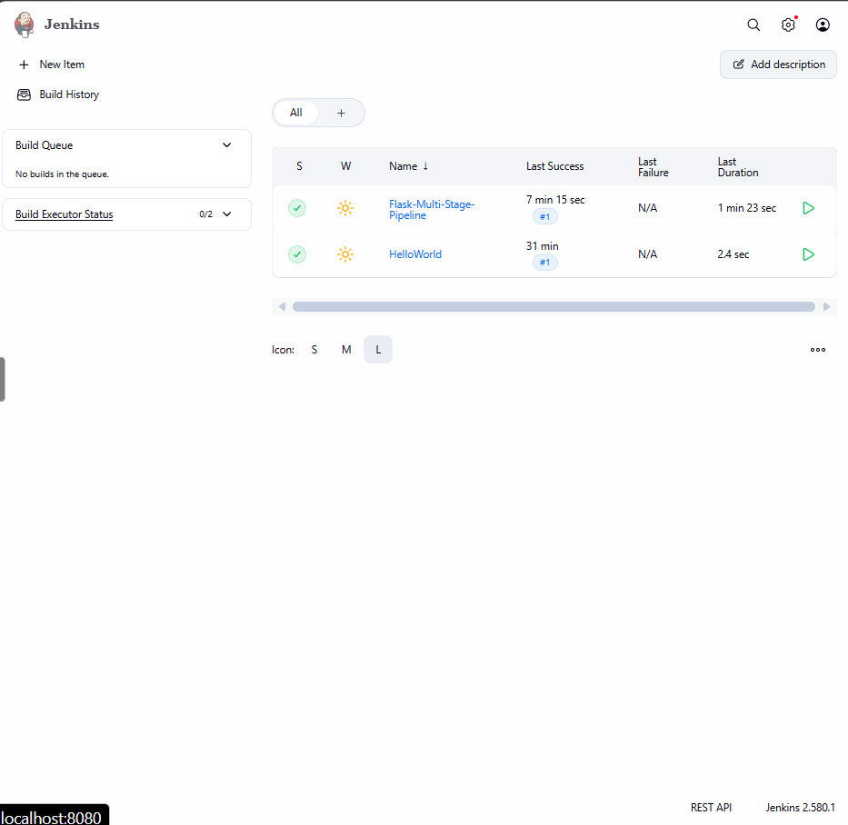
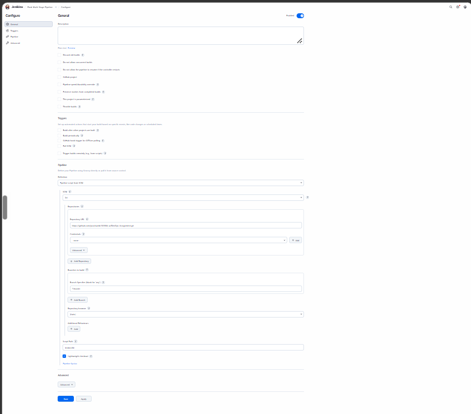
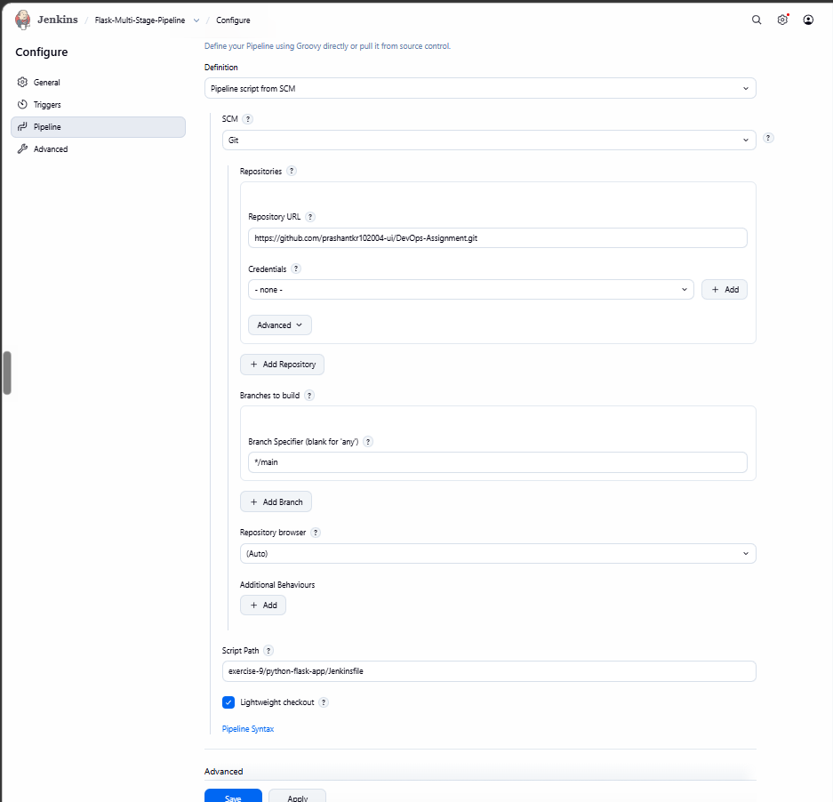
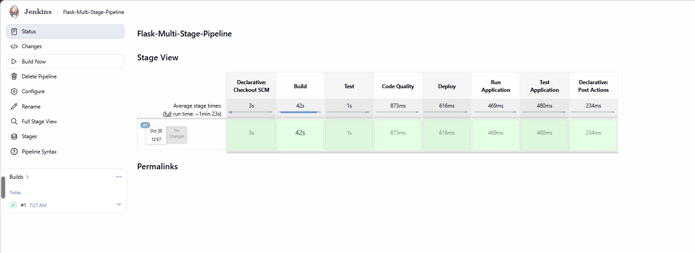
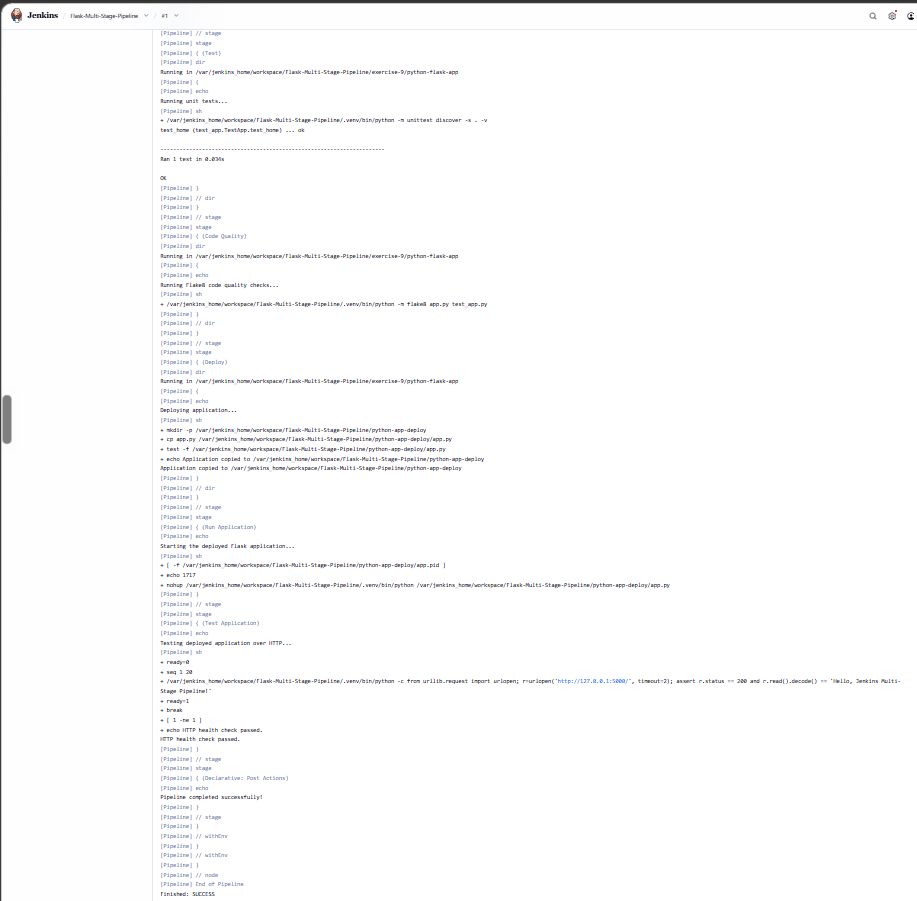

# Exercise 9 — Jenkins Multi-Stage Pipeline (Python Flask)

## Objective
Automate build, test, code-quality checks and a mock deployment of a Flask app with a declarative Jenkins pipeline.

## Files (`python-flask-app/`)
| File | Purpose |
|------|---------|
| `app.py` | Flask app returning `Hello, Jenkins Multi-Stage Pipeline!` |
| `test_app.py` | `unittest` test for the home route |
| `requirements.txt` | Flask, Werkzeug, Flake8 |
| `Jenkinsfile` | The six-stage pipeline |

## Pipeline stages
1. **Build** — create a virtualenv and install dependencies
2. **Test** — run unit tests
3. **Code Quality** — run Flake8
4. **Deploy** — copy `app.py` to a mock deploy folder
5. **Run Application** — start the app in the background
6. **Test Application** — HTTP health check on port 5000

## Setup
Jenkins needs Python inside the container:
```powershell
docker run -d --name jenkins -p 8080:8080 -p 50000:50000 -v jenkins_home:/var/jenkins_home jenkins/jenkins:lts
docker exec -u root jenkins bash -c "apt-get update && apt-get install -y python3 python3-venv python3-pip"
```




Create a **Pipeline** job → *Pipeline script from SCM* → Git → `https://github.com/prashantkr102004-ui/DevOps-Assignment.git`



Branch `*/main`, script path `exercise-9/python-flask-app/Jenkinsfile`.



## Run it
Click **Build Now**.




> 📸 Screenshot: `HTTP health check passed.` and `Finished: SUCCESS`.

## Run locally (optional)
```powershell
cd python-flask-app
python -m venv .venv
.\.venv\Scripts\Activate.ps1
pip install -r requirements.txt
python -m unittest -v
python -m flake8 app.py test_app.py
```

## Result
All six stages passed: the unit test passed, Flake8 reported no issues and the HTTP health check succeeded.
